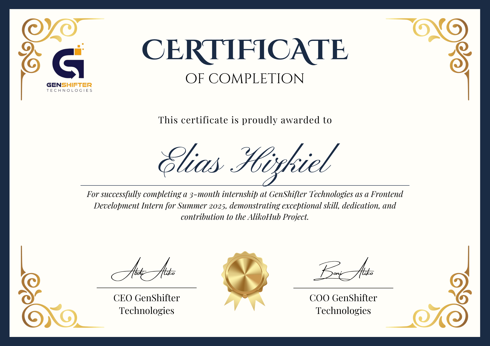

# Certificate of Completion — Frontend Development Internship

## Overview

This **Certificate of Completion** was awarded to **Elias Hizkiel** by **GenShifter Technologies** in recognition of the successful completion of a rigorous 3-month frontend engineering internship during **Summer 2025**. 

The certificate honors Elias's technical dedication, problem-solving abilities, and core contributions to **AlikoHub**—a key proprietary platform developed at GenShifter Technologies.

---

## Verbatim Credential Transcript

> **GENSHIFTER TECHNOLOGIES**
>
> ### CERTIFICATE OF COMPLETION
>
> *This certificate is proudly awarded to*
>
> ### **Elias Hizkiel**
>
> *For successfully completing a 3-month internship at GenShifter Technologies as a Frontend Development Intern for Summer 2025, demonstrating exceptional skill, dedication, and contribution to the AlikoHub Project.*
>
> **Signatures:**
> - **Abdi Aliko**, CEO GenShifter Technologies
> - **Boni Aliko**, COO GenShifter Technologies
> - *Official Gold Seal of Authentication*

---

## Project Context: AlikoHub

During his tenure at GenShifter Technologies, Elias served as a foundational frontend developer on the **AlikoHub Project**:

- **System Architecture:** Engineered user-facing modules and responsive web interfaces for complex workflow management.
- **Client & Stakeholder Experience:** Implemented dynamic dashboards connecting multiple roles (clients, contractors, and inspectors).
- **Core Technology Stack:**
  - Modern JavaScript / TypeScript frontend frameworks.
  - Reactive state management across distributed views.
  - Asynchronous RESTful API integrations and real-time data binding.
  - Semantic HTML5, accessible CSS layouts, and cross-browser responsiveness.

---

## Core Competencies Demonstrated

1. **Frontend Architecture & Engineering:** Built clean, reusable, component-based user interfaces.
2. **API & Data Pipeline Integration:** Bound complex backend endpoints with front-end views, handling loading, validation, and error states gracefully.
3. **Collaboration & Agile Delivery:** Participated in sprint planning, code reviews, and cross-functional feature rollouts with project managers and designers.
4. **Code Quality & Optimization:** Refined component lifecycles to guarantee performant page load speeds and minimal UI latency.

---

## Signatories & Issuer Information

- **Issuing Entity:** GenShifter Technologies
- **Executive Endorsements:**
  - **Abdi Aliko** — Chief Executive Officer (CEO), GenShifter Technologies
  - **Boni Aliko** — Chief Operating Officer (COO), GenShifter Technologies
- **Repository Location:** [`certificates/Elias Certificate of Completion.png`](https://github.com/elijahizkiel/certificates/blob/main/Elias%20Certificate%20of%20Completion.png)
