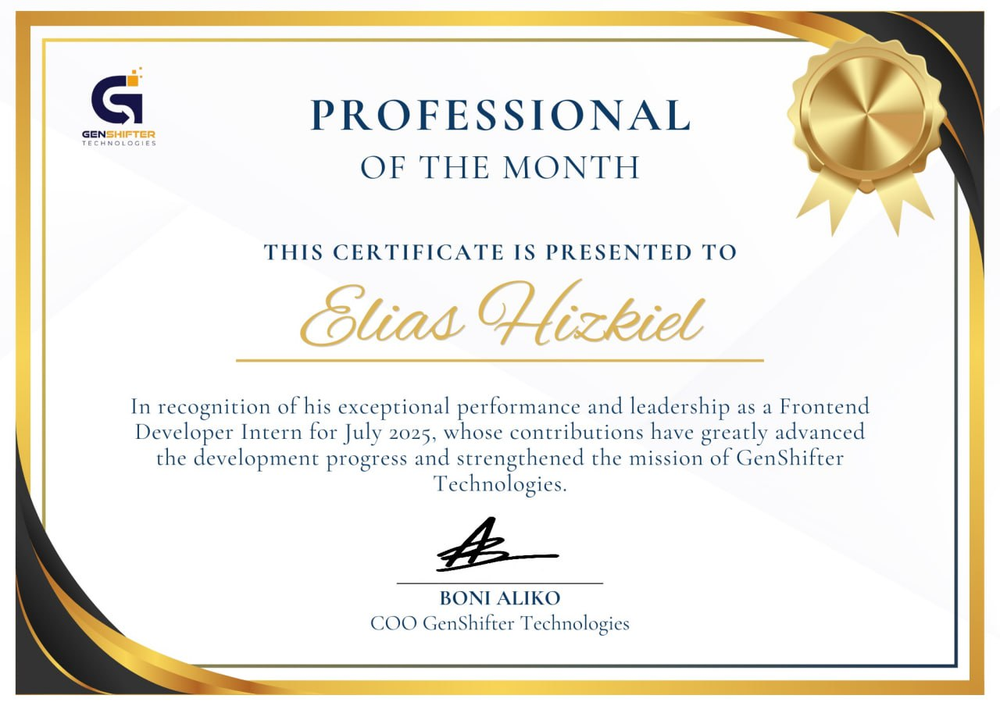

# Professional of the Month — July 2025

## Overview

The **Professional of the Month (July 2025)** award was presented to **Elias Hizkiel** by executive leadership at **GenShifter Technologies**. 

This honor was bestowed in direct recognition of his exceptional performance, initiative, and peer leadership while serving as a Frontend Developer Intern. Elias outperformed delivery expectations, accelerated technical milestones on company flagship projects, and elevated development velocity across his engineering cohort.

---

## Verbatim Credential Transcript

> **GENSHIFTER TECHNOLOGIES**
>
> ### PROFESSIONAL OF THE MONTH
>
> *THIS CERTIFICATE IS PRESENTED TO*
>
> ### **Elias Hizkiel**
>
> *In recognition of his exceptional performance and leadership as a Frontend Developer Intern for July 2025, whose contributions have greatly advanced the development progress and strengthened the mission of GenShifter Technologies.*
>
> **Signature:**
> - **BONI ALIKO**, COO GenShifter Technologies
> - *Gold Medallion & Ribbon Insignia*

---

## Key Achievements Warranting Recognition

1. **Lead Frontend Ownership:**
   - Spearheaded frontend delivery during a critical sprint phase for the **Aliko ConTech** product suite.
   - Designed and deployed multi-role dashboards for clients, contractors, and inspectors ahead of schedule.

2. **Leadership & Peer Mentorship:**
   - Proactively assisted teammates in troubleshooting blocking UI and API integration bugs.
   - Maintained an exemplary standard of code reviews, documentation, and pull request hygiene.

3. **Performance & Initiative:**
   - Initiated refactoring of complex state-heavy components, significantly reducing render overhead and latency.
   - Maintained zero regressions in critical production paths during continuous integration cycles.

---

## Signatory & Issuer Information

- **Issuing Entity:** GenShifter Technologies
- **Executive Signatory:**
  - **Boni Aliko** — Chief Operating Officer (COO), GenShifter Technologies
- **Repository Location:** [`certificates/professional-of-the-month.jpg`](https://github.com/elijahizkiel/certificates/blob/main/professional-of-the-month.jpg)
